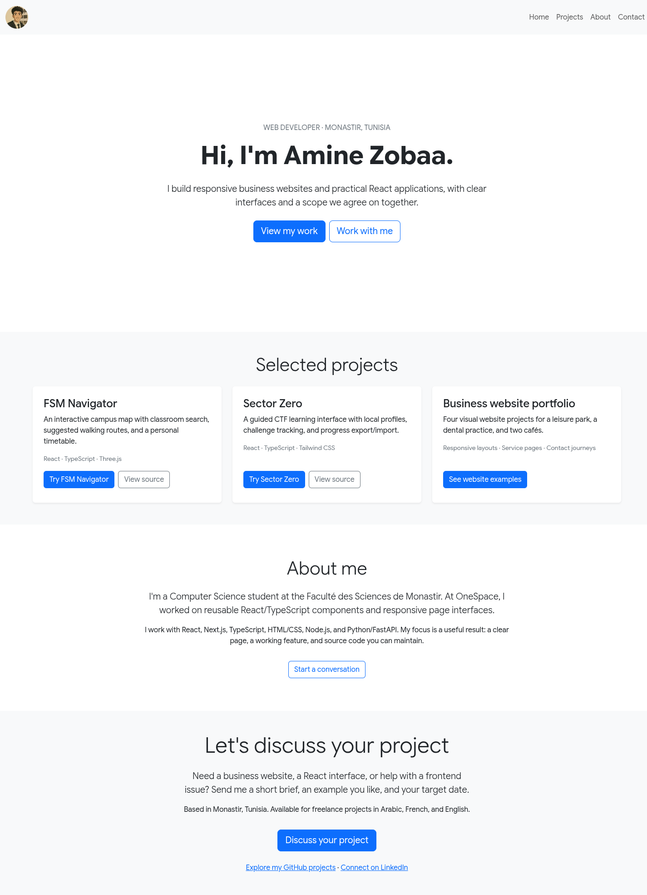

# Amine Zobaa — Web Developer Portfolio

[](https://github.com/zamine-dots/Portfolio-App/actions/workflows/ci.yml)

A responsive portfolio that introduces my web development work, links to runnable projects, and gives prospective clients a direct way to discuss a project.

[Live portfolio](https://portfolio-app-beta-three.vercel.app) · [Freelance profile](https://tunisiefreelance.tn/fr/profile/zobaa-a-b65c97)



## What visitors can do

- Explore FSM Navigator, Sector Zero, and website examples for local businesses.
- Open project demos and source repositories directly from the project cards.
- Read about my React, TypeScript, Next.js, and API experience.
- Reach my freelance profile or LinkedIn from the contact section.
- Navigate the page using a responsive menu with distinct section anchors.

## Run locally

Use **Node.js 24 LTS** (24.15 or later) and npm. An `.nvmrc` is included.

```bash
npm ci
npm run dev
```

Open the local URL printed by Vite. No environment variables or backend are needed.

```bash
npm test          # contact journey and navigation targets
npm run build    # production assets in build/
npm run preview  # serve the production build locally
```

## Implementation

React and Bootstrap provide the interface; Vite builds the site. Vitest and Testing Library check that visitors can discover work and reach the intended contact destination.

| File | Purpose |
| --- | --- |
| `src/components/Home.jsx` | Introduction and featured project cards |
| `src/components/About.jsx` | Background and technical focus |
| `src/components/Contact.jsx` | Freelance, GitHub, and LinkedIn links |
| `src/components/Navbar.jsx` | Mobile navigation and section scrolling |
| `index.html` | Page title and search description |

The contact action opens Tunisie Freelance. This static site does not collect or send contact-form data.

## Deploy

Run `npm ci` followed by `npm run build`, and publish **`build/`** on a static host. In Vercel, use the Vite preset and set the output directory to `build`. The output directory is intentionally retained from the earlier deployment setup.

GitHub Actions runs the tests, production build, and dependency audit on pushes and pull requests. Runtime layout checks are performed separately in a browser.
